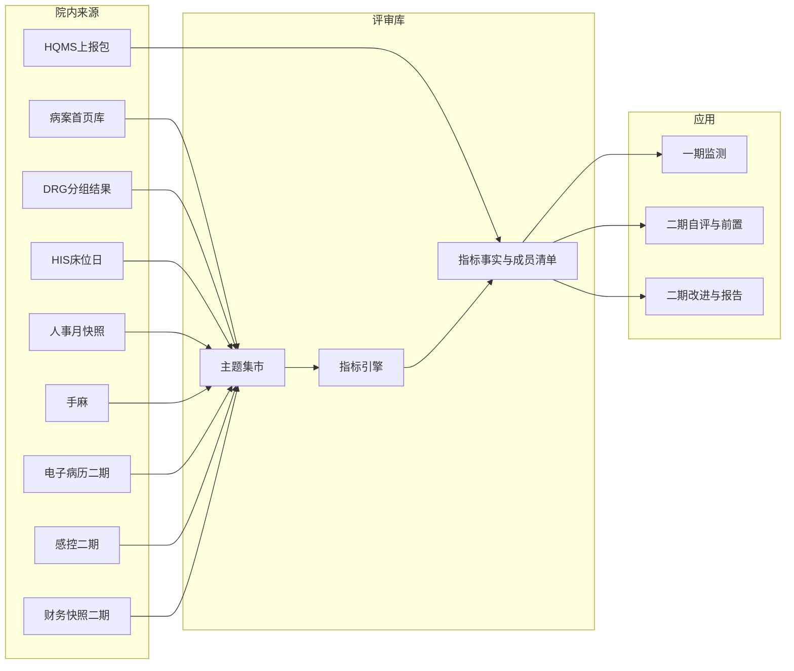

# 详细设计说明书

本文是医院等级评审系统的唯一规范正文。表名、字段名、状态枚举、原因码以本文为准。指标口径的计算例子和计分测试向量见 [02-指标包与计分规则.md](02-指标包与计分规则.md)。江城市第一人民医院的源系统、同步时刻和上线顺序见 [03-假设医院对接落地方案.md](03-假设医院对接落地方案.md)。二期阅读顺序见 [04-二期阅读索引.md](04-二期阅读索引.md)，该文不另定义表和状态。已登记的政策文件见 [05-政策文件登记.md](05-政策文件登记.md)，该文不另定义表和状态。

本次交付只有文档，不包含可运行工程。

## 1. 读者与边界

读者是后续负责后端、前端、数据同步和测试的项目组成员。

系统是三级医院的质量与评审运营系统。它把评审标准变成可执行指标，按月从院内主题表计算，把分子分母住院号留下来，并在二期做前置台账、模拟等次和改进闭环。它不替代 HIS、电子病历、病案编目和 DRG 分组器。

政策口径采用《三级医院评审标准（2025 年版）》：前置要求 4 节 29 条，监测数据 93 节 203 条，评审周期 4 年。省级选用的监测指标条数原则上不低于第二部分的 60%。等次按符合比例：甲等不低于 90%，乙等不低于 80%，丙等不低于 70%。核查错误、无法提供原始数据或虚假数据，错误条款占抽查条款超过 10% 时按违反前置要求处理。

技术栈：Java 17、Spring Boot 3、Vue 3、TypeScript、PostgreSQL、ECharts。院内部署。接口在本文用资源名和字段描述，不生成脚手架。

三期只留扩展点：同一指标可挂多个指标包（等级评审、国考、单病种），标杆值来自外部汇总表。第一期界面只做等级评审。

## 2. 分期

一期交付「能算、能对、能看」：

- 主题表、指标定义、月结、事实、血缘、分子分母清单
- 监测工作台、科室下钻、补录审核、红灯预警
- HQMS 病案级差异，以及条款级抽查（抽查可以在一期先算出错误率，写入结果表；前置台账的自动不符合放到二期读取该结果）
- 政策文件登记，以及等级评审包 `grade_review` 的换版。`public_performance` 可以登记，监测界面不打开

二期交付「能评、能改」：

- 佐证库、前置台账、省细则与选用集、模拟等次、改进单、自评报告
- `clinical_event`、`finance_year`
- 电子病历与感控适配器

二期只读一期已封存的事实批次。指标定义版本升级后，由人发起重跑对应月份。月结任务不自动覆盖已封存批次。

一期建表时包含二期表的空结构（至少包含本文列出的二期表），避免二期改表推倒月结。二期功能开关默认关闭。

## 3. 逻辑结构

同步账号只读源库。计算账号只读主题表和编码集，不连接 HIS。两个账号分开。

## 4. 枚举

全库统一使用下列取值，代码里用同一组常量。

| 名称 | 取值 | 含义 |
| --- | --- | --- |
| 灯号 `light` | `green` `yellow` `red` `na` | 日常管理。优于目标为绿；偏离但未到告警线为黄；劣于告警线，或连续两个月向坏方向变化为红；分母为 0 为不适用 |
| 计分原因码 `reason_code` | `pass` `median` `median_fail` `worst_year` `last_year_fail` `not_applicable` | 只由二期计分组件产生 |
| 批次状态 | `running` `success` `failed` | 失败批次不写事实 |
| 批次种类 `batch_kind` | `auto` `manual` | 补录审核通过后写 `manual` |
| 采集方式 | `auto` `manual` `evidence` | 佐证类没有数值 |
| 计分类型 `score_type` | `all_or_nothing` `interval_trend` | 规模类、配比类用前者；连续监测用后者 |
| 方向 | `high` `low` | 高优或低优 |
| 符合性 `compliance` | `compliant` `non_compliant` `unknown` | 前置条款的自查结论 |
| 前置流程 | `draft` `submitted` `accepted` `rejected` | 复核进度。`accepted` 只表示认可该结论，结论可以是不符合 |
| 改进单状态 | `opened` `assigned` `doing` `evidence_ready` `verified` `closed` | 可从任一状态进入 `reopened`，再回到 `doing` |
| 改进来源 | `red_light` `worst_year` | 两份待确认列表，不合成一次月结任务 |
| 关闭方式 `close_mode` | `improved` `not_recovered` | 后者必须填写说明，报告单独成节 |
| 成员角色 | `numerator` `denominator` | 分子或分母住院号 |
| 成员范围 `scope` | `dept` `hospital` | 科室清单与全院清单分开存 |
| SQL 状态 | `draft` `confirmed` | 月结只跑已确认且已到生效日的模板 |
| 政策文件类型 `policy_kind` | `national_standard` `interpretation` `indicator_pack` `reference` | 只表示文件是什么。是否改计分规则不写在这里 |
| 政策状态 `policy_status` | `draft` `analyzing` `blocked` `confirmed` `effective` `superseded` | 见第 5.8 节和第 6 节 |
| 政策影响目标 | `clause` `indicator_def` `code_set` `selection_set` `scoring_rule` | |
| 政策变更类型 | `add` `revise` `retire` `reference_only` | |

灯号不参与评审等次。等次只来自 `score_run`。

两套「变差」不要并成一个字段：

- 月结红灯、连续两个月变差：写入 `alert`，服务日常催办。
- `worst_year`：年度计分之后才有，服务等次和年度改进单。

## 5. 数据模型

主键未特别声明的，均为 `bigint` 自增 `id`。金额用 `numeric(18,2)`，指标值用 `numeric(18,6)`，时间用 `timestamptz`。字符集 UTF-8。

出院记录的业务键一律是 `inpatient_no` + `discharge_date`。不单独用住院号。

### 5.1 医院与科室

`hospital`：`name`，`approved_bed`（核定床位），`planned_bed`（规划床位）。

`campus`：`hospital_id`，`code`，`name`。当前假设医院只有一个院区，表结构仍按多院区建。床位规模按院区比较。

`dept_std`：标准科室。`code` 为主键，`name`，`is_clinical`，`owner_dept`（责任部门，可空）。保留两个系统编码：`ALL`（全院）、`UNMAPPED`（未对照）。这两个编码不出现在 `dept_map` 里。

`dept_map`：源系统到标准科室。

| 字段 | 类型 | 约束 |
| --- | --- | --- |
| source_system | varchar(32) | 非空。取值如 `his` `case` `hrp` |
| source_dept_code | varchar(64) | 非空 |
| source_dept_name | varchar(128) | 非空 |
| std_dept_code | varchar(64) | 可空。空表示尚未对照 |
| effective_from | date | 非空 |
| effective_to | date | 可空，空表示仍有效 |

唯一约束：`(source_system, source_dept_code, effective_from)`。

标准科室由质控办定名，信息科维护对照。科室排名只用对照成功的记录。对照失败的记录进入异常清单，同时计入全院 `ALL`。全院死亡率、手术占比、CMI 不因科室码缺失而变小。

### 5.2 标准、条款、指标

`standard_version` 只存国家版本和省细则，不把医院选用集再存一份。

| 字段 | 说明 |
| --- | --- |
| code | 如 `GB-2025`、`JC-2025` |
| name | 显示名 |
| kind | `national` 或 `province` |
| parent_id | 省细则指向国家版本；国家版本为空 |

`clause`：

| 字段 | 说明 |
| --- | --- |
| version_id | 所属 `standard_version` |
| chapter_no | 章 |
| section_no | 节 |
| clause_no | 条 |
| body | 正文 |
| clause_type | `prerequisite` 或 `monitoring` |
| is_scale | 监测条款是否按规模类、配比类计分 |
| national_indicator_code | 对应国标指标编码。同一国标指标只计一次 |
| dimension | `quality` `safety` `capability` `efficiency` `operation`，监测条款必填 |

前置条款没有分子分母。监测条款可以挂多个 `indicator_def`（例数与发生率拆开），但选用和符合比例按 `national_indicator_code` 计一次。

`indicator_def`：

| 字段 | 说明 |
| --- | --- |
| code | 指标编码 |
| name | 名称 |
| clause_id | 所属监测条款 |
| pack_code | `grade_review` 或 `public_performance`。一期界面只打开前者 |
| version | 从 1 递增 |
| effective_from | 生效日期 |
| direction | `high` 或 `low` |
| collect_mode | `auto` `manual` `evidence` |
| grain | `month` `quarter` `year` |
| annual_agg | `month_avg`、`year_end_snapshot`、`drg_formula`。人员比和床位规模用快照，禁止把 12 个月人数加总 |
| numerator_text / denominator_text / include_text / exclude_text | 给人读的说明 |
| sql_template | 只引用主题表和编码集参数 |
| sql_status | `draft` 或 `confirmed` |
| code_set_id | 可空 |
| time_field | `discharge_date` 或 `event_time` |
| owner_dept | 责任部门 |
| dept_rule | `discharge_dept` 或 `functional_dept` |
| score_type | `all_or_nothing` 或 `interval_trend` |

唯一约束：`(code, version)`。新模板或改版在质控办确认前保持 `draft`。月结选版本的规则见第 6 节：须已确认，且 `effective_from` 不晚于该周期结束日。

`indicator_target`：按年度配置目标，不写进定义永久不变。

| 字段 | 说明 |
| --- | --- |
| indicator_def_id | 指向某个版本 |
| year | 目标年 |
| comparator | `ge` `le` `gt` `lt` |
| target_value | 达标线 |
| warn_value | 告警线，用于黄灯和红灯 |
| band_json | 连续指标分档。没有分档也没有 `target_value` 的 `interval_trend` 指标不能进入选用集 |

空分母：结果为空，灯号 `na`，不参与符合比例。这条策略写死，不按指标配置。

`code_set`：`code`，`coding_system`（如国临 ICD-10、ICD-9-CM-3），`version_label`。

`code_set_item`：主键 `(code_set_id, item_code)`。编码集随指标版本引用，不把编码列表写死在 SQL 字符串里。

### 5.3 计算批次、事实、清单

`calc_batch`：

| 字段 | 说明 |
| --- | --- |
| batch_kind | `auto` 或 `manual` |
| period_type | `month` 或 `year` |
| period_start / period_end | 周期 |
| status | `running` `success` `failed` |
| operator_name | 操作者。定时任务写 `system` |
| started_at / finished_at | |
| is_current | 同一 `(batch_kind, period_type, period_start)` 只有一个 `success` 批次为 true |

批次不设单一口径版本。`calc_batch_item` 主键 `(batch_id, indicator_def_id)`，字段 `indicator_version`。重跑按这份清单取 SQL。

`indicator_fact`：

| 字段 | 说明 |
| --- | --- |
| batch_id | |
| indicator_def_id | |
| std_dept_code | `ALL`、`UNMAPPED` 或标准科室编码 |
| period_start / period_end | |
| numerator / denominator | 可空。佐证类不写事实 |
| value | 可空 |
| target_value | 取当年 `indicator_target`，可空 |
| light | |
| source | `auto` 或 `manual` |
| manual_value_id | 人工覆盖时指向补录单 |
| excluded_count | 再住院等指标中因主索引缺失而排除的人数，默认 0 |

唯一约束：`(batch_id, indicator_def_id, std_dept_code, period_start)`。

对外展示某周期某指标时，取 `is_current = true` 的自动批次。若同一指标同一周期另有当前人工批次，展示人工值，并标记「人工覆盖」。自动批次指针不被人工批次替换。血缘两边都保留。人工覆盖需要质控办权限。

`indicator_lineage`：`batch_id`，`indicator_def_id`，`source_tables`，`filter_summary`，`time_range`，`included_count`，`excluded_count`。给人阅读。核查复现不靠重放这段摘要。

`fact_member`：患者明细的唯一来源。

| 字段 | 说明 |
| --- | --- |
| batch_id | |
| indicator_def_id | |
| std_dept_code | 科室行、`UNMAPPED` 或 `ALL` |
| period_start | |
| member_role | `numerator` 或 `denominator` |
| scope | `dept` 或 `hospital` |
| inpatient_no | |
| discharge_date | |

主键：`(batch_id, indicator_def_id, std_dept_code, period_start, member_role, scope, inpatient_no, discharge_date)`。

未对照记录写入 `std_dept_code = UNMAPPED` 且 `scope = dept`，同时写入 `std_dept_code = ALL` 且 `scope = hospital`。明细页只读这张表，再关联主题表显示脱敏字段。不临时重查主题表重算名单。一年约 7 万出院，只存键，不复制首页全文。

`manual_value`：`indicator_def_id`，周期，`std_dept_code`，`value`，`submitter`，`status`（`draft` `submitted` `approved` `rejected`），`reviewer`，审核通过后的 `batch_id`。审核通过后写 `batch_kind = manual` 的事实，血缘指向本单而不是 SQL。

### 5.4 主题表

一期建齐下列表。二期只增加 `finance_year` 和 `clinical_event` 的写入，表可以在一期先建空表。

`visit_discharge`：

| 字段 | 说明 |
| --- | --- |
| inpatient_no + discharge_date | 主键 |
| empi | 患者主索引，可空 |
| admit_date / discharge_date | |
| source_dept_code | 源科室 |
| std_dept_code | 可空 |
| discharge_way | 离院方式 |
| los_days | 住院天数 |
| total_fee | 总费用 |
| is_surgery | 是否手术患者 |
| is_death | 离院方式为死亡时为 true |

低风险不回写在本表。计算时用 `dx` 加编码集判定。

`dx`：主键 `(inpatient_no, discharge_date, dx_seq)`。`dx_type`（主要、其他），`icd`，`coding_version`。

`oper`：主键 `(inpatient_no, discharge_date, oper_seq)`。`oper_code`，`coding_version`，`oper_level`，`incision`，`is_elective`。

`drg_group`：主键 `(inpatient_no, discharge_date)`。`drg_code`，`weight`，`actual_los`，`benchmark_los`，`actual_fee`，`benchmark_fee`，`grouper_version`。无分组结果的出院患者不插入行，并写入异常清单 `drg_missing`。CMI 分母只计有权重的行。评审系统不实现分组算法。

`bed_day`：主键 `(stat_date, campus_id, std_dept_code)`。`open_bed`，`occupied_bed_day`。

`staff_month`：主键 `(year_month, std_dept_code, post_type)`。`on_duty_count`。岗位类别至少能区分护士、医师、麻醉科医师。

`anes_month`：主键 `year_month`。全院一行：`or_room_count`，`general_anesthesia_count`。不按科室拆。麻醉科人数从 `staff_month` 取。

`hqms_discharge`：主键与首页相同。字段只保留对账要用的主要诊断、主要手术、离院方式、住院天数、费用、DRG 组（上报包有则存）。

`anomaly`：`batch_id` 可空（同步阶段也可写），`kind` 取 `unmapped_dept`、`empi_missing`、`drg_missing`、`event_unmapped`、`ssi_unlink`，以及 `inpatient_no`、`discharge_date`、`detail`。

患者主索引只用于跨就诊指标，例如出院后 0–31 天再住院。首页类比率以首页业务键计数。主索引为空时，该条仍进入死亡率等首页指标，只从再住院率的分子和分母中排除，`excluded_count` 随结果展示，并写 `empi_missing`。

### 5.5 对账

`reconcile_batch`：`period_start`（自然月），`created_at`。

`reconcile_item`：病案级。`inpatient_no`，`discharge_date`，`diff_type` 取 `missing_in_hqms`、`missing_in_home`、`main_dx`、`main_oper`、`discharge_way`、`los`、`drg`，`status` 取 `pending` 或 `explained`，`note`。

这一层只服务病案室清差，不进入 10% 错误率。

`audit_sample`：条款级抽查。`period_start`，`sample_rate`（不低于 0.20），`fact_batch_id`（首页月结批次），`error_rate`，`created_at`。

`audit_sample_item`：`indicator_def_id`，`home_value`，`hqms_value` 可空，`deviation` 可空，`result` 取 `ok`、`error_deviation`、`error_no_source`、`error_falsified`。

错误率 = `result` 以 `error_` 开头的条数 / 抽查条数。超过 0.10 时，二期把系统前置条款「数据真实性」的 `compliance` 写成 `non_compliant`，不允许人改回 `compliant`。月结和抽查都不改写已有 `indicator_fact`。

抽查名单从该月已成功计算、且能用首页或 HQMS 重算的监测指标中抽取，比例不少于 20%，名单落在 `audit_sample_item`。同一国标指标只抽一次。

### 5.6 预警

`alert`：`indicator_def_id`，`period_start`，`kind` 取 `red` 或 `two_month_worse`，`recipient`，`batch_id`，`created_at`。一期只写站内消息。短信和企业微信留字段 `channel`，一期固定 `inbox`。

### 5.7 二期表

`evidence_file`：

| 字段 | 说明 |
| --- | --- |
| owner_type | `prereq` `indicator` `improvement` `report` |
| owner_id | 所属对象主键 |
| file_name | |
| storage_key | 对象存储键 |
| uploader | |
| uploaded_at | |
| version_no | 同一对象递增 |
| voided | 作废。不物理删除 |

已进入锁定的前置周期，或已被 `report_export` 引用的文件，不能作废。

`prereq_case`：

| 字段 | 说明 |
| --- | --- |
| clause_id | 前置条款。另有一条系统条款，编码 `PREREQ-DATA-TRUTH`，不来自 29 条正文 |
| cycle_year_start / cycle_year_end | 评审周期 |
| compliance | `compliant` `non_compliant` `unknown` |
| workflow | `draft` `submitted` `accepted` `rejected` |
| owner_dept | |
| submitter / reviewer | |
| statement | 情况说明。不符合时必填 |
| public_consult_risk | 是否公开征询风险 |
| system_generated | 数据真实性条款为 true |
| locked | 周期锁定后为 true |

`prereq_correction`：更正。`prereq_case_id`，更正前的 `compliance` 和 `statement`，`reason`，`operator_name`，`created_at`。锁定后只能通过更正改写，原记录保留在更正表。

`selection_set`：`province_version_id`，`version_no`，`effective_year`，`approver`，`status`（`draft` `approved`），`require_evidence_when_compliant`。改选用集产生新版本，旧的 `score_run` 不跟着变。

`selection_item`：主键 `(selection_set_id, national_indicator_code)`。只能选用国家版本或该省细则里已有的指标，不能拆条新增。

`selection_exclusion`：主键 `(selection_set_id, national_indicator_code)`，`reason` 固定 `not_carried_out`。未开展的限制类技术和单病种必须写在这里。没有数据不能自动跳过。

`score_run`：`selection_set_id`，`cycle_year_start`，`cycle_year_end`，`year_count`，`trial`（覆盖年数不足 4 时为 true），`conform_count`，`included_count`，`ratio`，`grade`（`jia` `yi` `bing` `deferred`），`defer_reason` 可空，`adopted`（报告采用，全局同时只有一个 true），`created_at`。

`score_run_item`：`score_run_id`，`national_indicator_code`，`merged_value`，`conform`，`reason_code`，`year_values_json`（各年原始值）。

`score_run_batch`：`score_run_id`，`year`，`calc_batch_id`。模拟等次引用的年度批次，保证报告数字可复现。

`improvement_case`：

| 字段 | 说明 |
| --- | --- |
| indicator_def_id | |
| origin | `red_light` 或 `worst_year` |
| status | 见第 4 节 |
| open_batch_id | 开单时事实批次 |
| baseline_value | |
| target_value | |
| reason_text | |
| action_text | |
| owner_user | |
| due_date | |
| close_batch_id | 可空 |
| close_value | 可空 |
| close_mode | `improved` 或 `not_recovered` |
| close_note | `not_recovered` 时必填 |

`improvement_candidate`：待确认，尚未生成改进单。`origin`，`indicator_def_id`，`batch_id` 或 `score_run_id`，`status` 取 `pending` `accepted` `dismissed`。质控办接受后才插入 `improvement_case`。

`finance_year`：主键 `year`。`staff_expense`，`business_expense`，`source` 取 `import` 或 `manual`。一期不写入、不参与样例指标。

`clinical_event`：`inpatient_no`，`discharge_date` 可空，`visit_no` 可空，`event_type`，`event_time`，`std_dept_code`，`qualified`，`source_system`，`source_pk`。感控和电子病历都写成这种事件。指标 SQL 只认 `event_type`。

`event_dict`：`source_system`，`source_event_code`，`event_type`，`qualify_config_key`。对不上的事件写 `event_unmapped`，不进入分子分母。

`report_export`：`score_run_id`，`prereq_cycle_year_start`，`audit_sample_id`，`storage_key`，`exported_by`，`exported_at`。数字只从 `score_run_item` 和 `indicator_fact` 填入。

`audit_log`：与业务库分表，应用账号只有插入权限。`actor`，`action`，`object_type`，`object_id`，`detail`，`created_at`。信息管理员不能删除。

### 5.8 政策文件

政策文件是条款和指标变更的依据。上传只产生待分析记录，不修改 `indicator_fact`，不切换当前批次，不改 `adopted = true` 的 `score_run`。正文不入库。第一版目录见 [05-政策文件登记.md](05-政策文件登记.md)。

`policy_document`：

| 字段 | 说明 |
| --- | --- |
| doc_code | 同一文件各版本共用，如 `GB-2025-STANDARD` |
| title | 标题 |
| doc_no | 文号，可空 |
| issuer | 发文机关 |
| published_on | 发布日 |
| effective_on | 文件生效日 |
| storage_key | 对象存储键。前缀 `policy/`，不写入 `evidence_file` |
| content_hash | 文件哈希 |
| kind | `policy_kind` |
| status | `policy_status` |
| supersedes_id | 上一版 `policy_document.id`，首版为空 |

同一 `content_hash` 再次上传时拒绝并提示重复，不另建根记录。内容变化则新建一行：`doc_code` 不变，`supersedes_id` 指向旧行，旧行改为 `superseded`。已关联的历史批次不改。

`policy_impact`：

| 字段 | 说明 |
| --- | --- |
| policy_document_id | |
| target_type | `clause`、`indicator_def`、`code_set`、`selection_set`、`scoring_rule` |
| change_type | `add`、`revise`、`retire`、`reference_only` |
| target_id | 分析完成前可空。确认前必须填上，`scoring_rule` 和 `reference_only` 可以只填说明 |
| pack_code | `grade_review` 或 `public_performance`。参考行可空 |
| note | 改了纳入、排除、阈值、生效日，或指向哪条前置、哪个事件指标 |

一份文件保持一个 `kind`，多种后果用多行 `policy_impact`。`reference` 也必须有影响行。

存在 `target_type = scoring_rule` 的行时，文件状态只能到 `blocked`，不能变为 `confirmed` 或 `effective`，其名下新指标版本不进月结。`scoring_rule` 仅用于 60% 选用比例、甲乙丙阈值、抽查比例 20%、条款错误率 10%、全或无和取最差。放开前必须先改本文和计分函数，并删除或关闭该影响行。

换版规则：

- 国家标准或省细则换版：新建 `standard_version` 和 `clause`。延续的指标沿用原 `national_indicator_code`，`indicator_def.version` 加一，SQL 为 `draft`。
- 废止：`change_type = retire`。新批次不再计算该指标。旧事实保留。
- 政策解读只改口径：不新建 `standard_version`。相关指标加版本。
- 编码名单变化：新建 `code_set`。旧批次仍指向旧集。
- 旧 `selection_set` 仍指向原省细则，不自动改挂。新国家版本第一次计分前另建选用集。60% 的分母改为新国家版本中的监测指标条数。

`pack_code` 允许 `grade_review` 与 `public_performance`。一期界面只打开前者。

## 6. 月结流水线

定时与手工重跑走同一套步骤。

1. 插入 `calc_batch`，状态 `running`。写入本次要跑的指标及版本。入选条件同时满足：`sql_status = confirmed`；`effective_from` 不晚于该周期结束日；若该版本挂在某条 `policy_impact` 上，对应 `policy_document.status` 为 `effective`。没有政策影响行的种子指标，在 SQL 已确认且已到 `effective_from` 时即可入选。`retire` 的指标不进入新批次。`blocked` 政策指向的新版本不进入。同一 `code` 取满足上述条件的最高 `version`。
2. 检查首页月分区是否到齐（该自然月 `visit_discharge` 已由同步作业标记封账）。分区缺失则批次 `failed`，不写事实。科室未对照和主索引失败只写 `anomaly`，不因此失败，也不从 `ALL` 删除记录。
3. 按清单顺序，用计算角色执行 SQL 模板。参数只有周期起止和 `code_set_id`。禁止多语句，禁止分号后的第二段 SQL。模板引用范围限于主题表和 `code_set_item`。
4. 写 `indicator_fact`、`indicator_lineage`、灯号、`fact_member`。未对照记录进入 `UNMAPPED`，同时进入 `ALL`。
5. 成功后把同周期旧的自动当前批次 `is_current` 置为 false，本批次置为 true。该月对外只读。病案级差异和条款抽查都不在这一步改事实。

灯号计算在事实写入之后：与 `indicator_target` 比较。分母为 0 或值为空则为 `na`。连续两个月向坏方向变化时，即使未过告警线也写 `red`，并写 `alert.kind = two_month_worse`。红灯写 `alert.kind = red`。

年度事实（每年 1 月，仍属一期，不调用计分组件）：

- `all_or_nothing` 且 `annual_agg = year_end_snapshot`：取 12 月快照，不取平均。
- `interval_trend` 且 `annual_agg = month_avg`：取月均值。
- `annual_agg = drg_formula`：按 [02-指标包与计分规则.md](02-指标包与计分规则.md) 的年度公式，从 `drg_group` 直接汇总，不把 12 个月的 CMI 再平均。

年度批次同样写 `fact_member`。不足月的年份不生成年度事实。

补录：`manual_value` 审核通过后另开 `batch_kind = manual` 的批次，只含该指标。不把自动批次的 `is_current` 改掉。展示层若存在当前人工批次，优先显示人工值。

重跑：新建批次，成功后切换指针。失败批次保留，不对外展示。请求的周期早于该指标 `effective_from` 时接口拒绝，不建批次。重跑不修改 `adopted = true` 的 `score_run`。

政策文件从登记到可被月结选中，分三步，不在同一次确认里完成：

1. 信息科登记文件，状态 `draft`。质控办填写 `kind` 和影响行后进入 `analyzing`。出现 `scoring_rule` 则进入 `blocked` 并停止。
2. 质控办确认影响清单，并确认其名下仍为 `draft` 的 SQL。文件变为 `confirmed`。此时月结仍用旧版本。
3. 到达文件 `effective_on`，且对应 `indicator_def.effective_from` 已到，状态变为 `effective`。此后的周期才能选中新版本。

计分取值另计：周期中发布的政策，从下一个完整年进入合并，发布当年不进入。这个过滤在二期组年度值时做，不靠把月结版本提前改掉。

确认、进入 `blocked`、变为 `effective`、替换版本，都写入 `audit_log`。

## 7. SQL 执行约束

- 计算角色对主题表和 `code_set_item` 仅有 `SELECT`，没有业务表写权限，也不能访问源系统只读库。
- 同步角色只出现在同步作业里，不用于指标 SQL。
- 应用在执行前检查模板：去掉注释后若包含分号，或出现主题表白名单之外的标识符，拒绝执行并把该指标记入批次错误，不让整句拼进库。
- 白名单表：`visit_discharge`、`dx`、`oper`、`drg_group`、`bed_day`、`staff_month`、`anes_month`、`clinical_event`、`finance_year`、`code_set_item`。
- 质控办确认模板的动作写 `audit_log`，权限码 `indicator.sql.confirm`。

## 8. 条款级抽查算法

在首页月结批次成功、且当月 `hqms_discharge` 已装载之后执行。

1. 取该月 `is_current` 自动批次中、`collect_mode = auto` 且 `std_dept_code = ALL` 的指标，按 `national_indicator_code` 去重。
2. 抽取不少于 20%。抽样比例存在 `audit_sample.sample_rate`。名单一旦写入不可改，重抽必须新建 `audit_sample`。
3. 对每一条，用同一指标的 SQL 模板，把事实来源从首页表换成 `hqms_discharge` 所能覆盖的字段再算一次。模板若依赖 HQMS 没有的字段，`result = error_no_source`。
4. `hqms_value` 与 `home_value` 的相对偏差绝对值大于等于 0.10，`result = error_deviation`。分母为 0 而两边都为空，视为 `ok`。一边为空一边有值，视为 `error_no_source`。
5. 质控办可将某条标为 `error_falsified`。
6. 错误率超过 0.10 只写 `audit_sample.error_rate`，不改事实。二期前置任务读取该字段。

病案级差异的产生规则见第 5.5 节，与上述步骤独立。一份首页主要诊断不一致，本身不是一条条款错误。

## 9. 一期应用

一套指标工作台。章节、责任部门、灯号、周期是筛选条件，不按五个章节做五套页面。

| 角色 | 能做的事 |
| --- | --- |
| 院领导 | 全院灯号分布、分章红灯数、连续两个月变差列表、责任部门排名。没有患者明细入口 |
| 质控办 | 打开定义、分子分母、近 12 个月、科室分布；下钻脱敏明细；发起和审核补录；看病案差异和抽查结果；确认 SQL 模板；填写政策分类和影响并确认 |
| 临床科室 | 只看本人标准科室的事实和明细。不能改口径 |
| 病案室 | 处理 `reconcile_item`。不能改指标定义 |
| 信息管理员 | 登记政策文件。不能确认口径，不能改指标定义 |

下钻顺序：全院事实 → 标准科室事实 → `fact_member` 中该科室的住院号 → 主题表脱敏字段。明文需要额外权限，见第 11 节。

### 9.1 资源

前缀 `/api`。列表一律分页，参数 `page`、`size`。写操作返回对象 id。

| 方法 | 路径 | 说明 |
| --- | --- | --- |
| GET/POST | `/indicator-defs` | 查询、新建草稿。POST 权限 `indicator.def.write` |
| POST | `/indicator-defs/{id}/confirm` | 确认 SQL。权限 `indicator.sql.confirm` |
| GET | `/calc-batches` | 批次及条目 |
| POST | `/calc-batches` | 手工重跑。权限 `batch.rerun`。体：周期、指标编码列表 |
| GET | `/facts` | 查询当前事实。筛选章、部门、灯号、周期、科室 |
| GET | `/facts/{id}/members` | 分页读 `fact_member`。权限 `fact.read`。明文另需 `fact.patient.read` |
| POST | `/manual-values` | 补录提交 |
| POST | `/manual-values/{id}/review` | 审核。权限 `manual.review` |
| GET/PATCH | `/reconcile-items` | 病案差异。PATCH 只允许改 `status` 和 `note`。权限 `reconcile.handle` |
| POST | `/audit-samples` | 发起抽查。权限 `audit.sample.run` |
| GET | `/alerts` | 当前用户的站内预警 |
| GET/PUT | `/dept-maps` | 科室对照。PUT 权限 `dept.map.write` |
| GET/POST | `/policy-documents` | 登记与列表。POST 权限 `policy.write`。哈希重复时返回已有 id，不新建 |
| POST | `/policy-documents/{id}/impacts` | 填写影响行。权限 `policy.confirm` |
| POST | `/policy-documents/{id}/confirm` | 确认影响和名下 SQL，状态变为 `confirmed`。存在 `scoring_rule` 时拒绝。权限 `policy.confirm` |

患者明细导出默认关闭，没有导出路径。若实施时医院书面要求打开，另加 `POST /facts/{id}/members/export`，权限与 `fact.patient.read` 相同，并写审计：导出人、指标、条数、批次号。

明细查询审计：谁、何时、住院号、指标、批次。院领导调用成员接口返回 403。

## 10. 二期设计

二期全部建立在已封存批次上。`score_run` 通过 `score_run_batch` 引用年度批次号。

### 10.1 前置台账

29 条按 4 节预置，正文从国家标准录入。系统不自动解释法律结论。4 节为：床位规模与科室设置、依法执业与规范服务、公益性责任与行风诚信、安全管理与重大事件。

第 30 条是系统条款 `PREREQ-DATA-TRUTH`。读取最新 `audit_sample.error_rate`。超过 0.10 时 `compliance = non_compliant` 且 `system_generated = true`，接口拒绝把它改成 `compliant`。

流程：

1. 质控办按评审周期生成全部 `prereq_case`，`workflow = draft`，`compliance = unknown`。
2. 责任部门填写 `compliance` 和 `statement`，提交后 `workflow = submitted`。
3. 质控办复核。认可则 `accepted`。退回则 `rejected`，责任部门改完再提交，状态回到 `submitted`。`accepted` 不代表符合。
4. 全部条款 `workflow = accepted` 且没有 `unknown` 后，周期 `locked = true`。
5. 锁定后的修改写入 `prereq_correction`，然后更新当前行。

符合性为 `non_compliant` 时必须有 `statement`，且至少一份未作废的 `evidence_file`（`owner_type = prereq`）。符合不强制附件，除非该 `selection_set.require_evidence_when_compliant = true`。

床位提示：用 `bed_day` 的开放床位与 `hospital.planned_bed`、`campus` 比较。超过规划时在台账上显示提示。人仍然手工选择符合性，系统不用这个比较直接判不符合。

任一 `compliance = non_compliant`，医院级横幅显示延期评审风险。

### 10.2 选用集

三层：国家版本、省细则、医院 `selection_set`。江城省细则的具体约束在对接方案里配置，全国换省时只改配置，不改代码分支。

保存选用集前检查，不通过则拒绝 `approved`：

- `selection_item` 条数 / 该选用集所依据的国家版本监测指标条数 ≥ 0.60。按 `national_indicator_code` 计数，不按节计数。换国家版本后分母改为新版本条数，且必须新建 `selection_set`，不改旧行。
- `dimension` 的质量、安全、能力、效率、运行每一类至少一条。
- 省细则标记为必选、且未出现在 `selection_exclusion` 的指标必须入选。
- 医院声明开展的限制类技术，对应指标必须入选。
- 每条 `interval_trend` 在生效年有 `indicator_target.target_value` 或 `band_json`。
- 不得插入国标和省细则之外的新指标编码。

### 10.3 模拟等次

一期不调用计分组件。二期 `score_run` 调用。组件是纯函数，规格和测试向量在 [02-指标包与计分规则.md](02-指标包与计分规则.md)。

输入：选用集、最多 4 个完整年的年度事实、连续指标的阈值表。输出：合并值、是否符合、`reason_code`、`year_count`。

`year_count < 4` 时 `score_run.trial = true`，`grade` 仍可计算，界面标明试算，不能当作评审结论。

符合比例 = `conform_count / included_count`。灯号 `na` 的指标不纳入。前置任一条款不符合，或最新条款抽查错误率超过 10%，`grade = deferred`，监测比例仍展示。

等次：比例 ≥ 0.90 为 `jia`，≥ 0.80 为 `yi`，≥ 0.70 为 `bing`，否则不设等，仍用 `deferred` 以外的空等表示未达丙等（`grade` 为空，`defer_reason` 为空）。延期评审优先于等次。

同一时间只有一个 `adopted = true`。把某次标为报告采用时，先把其他记录的 `adopted` 置为 false。

结果页每一行展示各年原始值、`reason_code`、是否符合。`last_year_fail` 时界面根据原因码显示「最后一年未达标」。不另写一套与原因码无关的文案规则。

### 10.4 改进闭环

月结成功后，全院红灯写入 `improvement_candidate.origin = red_light`。年度 `score_run` 完成后，`reason_code = worst_year` 的指标写入另一份候选，`origin = worst_year`。不在月结当夜写 `worst_year`。

质控办将候选标为 `accepted` 后生成 `improvement_case`，初始 `opened`。`dismissed` 不生成单据。

状态只允许：

- `opened` → `assigned`（指定 `owner_user`）
- `assigned` → `doing`
- `doing` → `evidence_ready`（已有未作废证据，且措施已填）
- `evidence_ready` → `verified`（质控办）
- `verified` → `closed`
- 除 `closed` 外可 → `reopened` → `doing`
- `closed` → `reopened` 仅质控办

关闭条件同时满足：状态路径走到 `verified`，责任部门已提交措施和证据，并且下面二者之一成立。

- `close_mode = improved`：`close_batch_id` 指向开单之后的下一个统计周期，且该事实值优于 `baseline_value`（按指标方向比较）。
- `close_mode = not_recovered`：`close_note` 非空。报告里这种关闭单独成节。

临床科室只能读写分配给自己的单。质控办可以改派和退回（`verified` 退回 `doing`）。

### 10.5 佐证与报告

佐证库在二期第一周启用，前置台账依赖它。一期不提供上传接口。

同一 `owner_type + owner_id` 再次上传时 `version_no` 加 1，预览默认最大版本且 `voided = false`。删除接口改为作废。

自评报告章节固定，顺序不可配置：

1. 医院概况与床位（含院区）
2. 前置符合情况
3. 选用集及不低于 60% 的说明
4. 取值规则：完整年、政策次年起算、月均或年末快照
5. 分章监测结果表
6. 取最差清单（`reason_code = worst_year`）
7. 改进单，其中 `not_recovered` 单独一节
8. HQMS 病案差异概要与条款抽查错误率
9. `selection_exclusion` 中声明未开展的技术

`report_export` 必须绑定一次 `score_run`、已锁定的前置周期、一次 `audit_sample`。导出 Word。表内数字来自 `score_run_item` 和事实表。叙述使用固定句式，例如「本指标合并值取最差年 {year}」。生成过程不改写数字。文末打印 `score_run.id` 和各年 `calc_batch.id`。

后期若接院内模型，只允许填充叙述空位，空位与数字单元格分离。本文不要求实现该模型。

### 10.6 电子病历与感控

不新增下钻页面。适配器写入 `clinical_event` 后，SQL、血缘、`fact_member`、权限与首页指标相同。明细多显示 `event_time` 和 `qualified`。

感控分子必须能用 `inpatient_no + discharge_date` 连回 `visit_discharge` 或 `oper`。连不上的不进分子，写 `anomaly.kind = ssi_unlink`。

一期主题表结构不被事件接入修改。

## 11. 权限、审计与部署

角色：院领导、质控办、病案室、职能科室负责人、临床科室用户、信息管理员、审计员。审计员只读 `audit_log`。

| 权限码 | 作用 |
| --- | --- |
| indicator.def.write | 维护定义草稿和年度目标 |
| indicator.sql.confirm | 确认 SQL 模板 |
| batch.rerun | 重跑月结或年度 |
| fact.read | 读事实和脱敏明细 |
| fact.patient.read | 打开明文 |
| manual.review | 审核补录 |
| reconcile.handle | 处理病案差异 |
| audit.sample.run | 发起条款抽查、标记虚假 |
| prereq.review | 复核前置、锁定、更正 |
| selection.approve | 审批选用集 |
| score.publish | 运行计分、标记报告采用 |
| improvement.dispatch | 接受候选、改派、退回、关闭复核 |
| report.export | 导出 Word |
| dept.map.write | 维护科室对照 |
| policy.write | 登记政策文件、上传新版本 |
| policy.confirm | 填写影响行、确认政策、确认其名下 SQL |

必须审计：患者明细查询、明细导出、事实人工覆盖、批次重跑、SQL 确认、政策确认、政策进入 `blocked`、政策生效、政策替换、前置锁定与更正、报告导出。登录失败不要求入库。日志保留不少于 6 个月。

部署：两台应用，PostgreSQL 一主一备，佐证放院内对象存储。无公有网上的患者接口。会话超时和口令策略按等保三级常见项写入实施说明，不在应用里自建第二套身份源：对接医院现有统一认证；统一认证未就绪时使用本地账号，密码不明文存储。每日备份。验收清单包含一次恢复演练。

患者明细默认脱敏：姓名不落主题表；住院号在无 `fact.patient.read` 时只显示后四位。

## 12. 开发任务切分

一期可并行的五块：

1. 主题表、同步作业约定、`dept_map`、异常清单。
2. 指标定义、SQL 沙箱、月结引擎、`fact_member`。引擎测试使用 [02-指标包与计分规则.md](02-指标包与计分规则.md) 的固定输入，不依赖医院网络。月结选版本时遵守第 6 节的生效日和 `retire` 规则。
3. 监测前端与第 9.1 节资源。
4. 补录审核、病案差异、条款抽查。
5. 政策文件登记与等级评审包换版。种子目录使用 [05-政策文件登记.md](05-政策文件登记.md)。`public_performance` 只登记，不进一期界面。

二期在一期事实表有稳定的当前批次之后开工，顺序固定：

佐证库 → 前置台账 → 选用集约束 → 计分组件 → 模拟等次页 → 改进单 → 报告导出 → `clinical_event` 适配器。

计分组件优先做纯函数测试，用例见指标包文档：中位数未达标、最后一年未达标、偶数年份的中位数、取最差、空分母、没有阈值不能入选用集、抽查错误率超过 10%。
